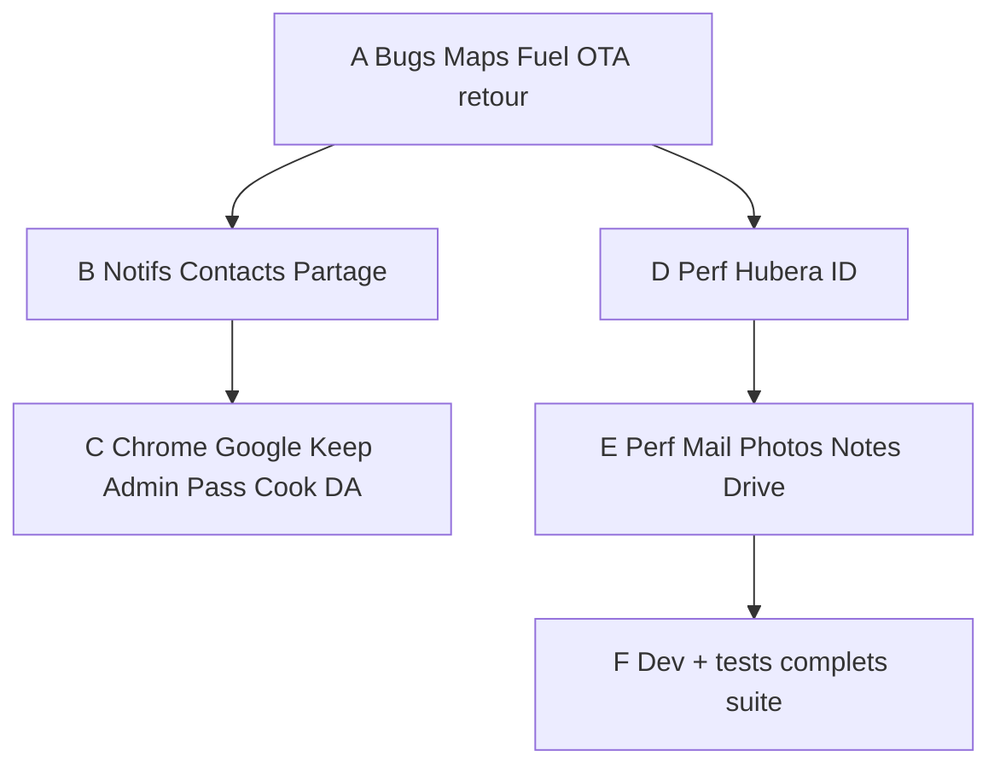

# Plan unique Hubera — 13 oct 2026

**Ce fichier est la seule source produit.** Lots 0–10 du 12 oct : **clos** (livrés). Le plan Cursor à exécuter ensuite est `plan_unique_exécution_acbc65e7.plan.md`. On n’en crée plus d’autres.

Test réel Paul (13 oct, 206 grise essence, labo + compte). Rien n’est « déjà bon » sans re-test.

Contraintes inchangées : pas de `docker compose down -v`, OTA `forceUpdate: false` / `mandatory: false`, overlay Samsung + Blackview `-r`, **pas d’ADB Nothing**, Watchtower OFF, dual APK. Secrets jamais dans git/Docs/mail.

Modèle UX : **Google** (Gmail / Maps / Calendar / Keep / Drive) + chrome **Hubera Music** (OTA, compte, retour). Palette par app, même mécanique.

**Suite (lot G, 15 oct)** : landings `hubera.cloud` et des apps (Music, Drive, Calendar, …) dans **Hubera CMS**, compte Paul, éditeur = tronc commun **VTCBuilder** (pas une copie de l’éditeur). L’app web métier de chaque produit reste dans son dépôt.

Bugs relevés Paul, à traiter avant de cocher F :

- Music : swipe suivant / précédent relance le titre courant.
- Maps : bouton Music et bouton position se chevauchent. Music trop petit. L’overlay Music cache la jauge et les contrôles qui doivent rester au-dessus sur l’axe vertical.
- Maps : sélecteur de véhicule pas ergonomique. Le suivi démarre seul au bout de 3 s sans validation (à retirer). Jauge = compteur Maps, pas le slider actuel. Petit bouton tableau de bord : afficher / masquer la jauge, clim, chauffage et degré, pour la conso.
- Docs mobile : bandes noires haut et bas, l’écran n’est pas rempli.
- Admin : catalogue des erreurs Music (mails) groupées par app, puis tâches.

Ordre : A–C **code/overlay Maps Fuel**. **Lot E (13 oct soir)** : Mail/Photos/Notes/Drive trop lents, IMAP OVH, DA type Music — **pas clos**. DA Contacts/Cook/Drive **dans E**, pas de redraw Music/Maps/Fuel.

**Suite (lot F, à partir du 13 oct soir)** : développement **et** test complet de Notes, Pass, Office, Photos, Stream, Taskflow, **plus** test complet (tous les cas) de Music, Maps, Mail, Fuel, Drive, et le reste de la suite (Contacts, Calendar, Cook, Jobs, Budget, ID, Docs). Rien n’est clos sans case cochée sur **web + Samsung + Blackview**. Nothing : sideload seulement, pas d’ADB.

---

## A — Maintenant (Maps, Fuel, OTA, bouton retour)

### A1. Maps : mode sombre en guidage — **livré 0.1.94 overlay Samsung+BV**
HUD / tuiles / chrome restent sombres une fois l’itinéraire démarré (`body.nav.night`). Auto = thème système **ou** 21h–6h.

### A2. Maps : commandes vocales — **livré 0.1.94 overlay Samsung+BV**
TTS recréé au retour premier plan, file d’attente, AudioFocus (duck Music), réannonce de la manœuvre. Plus de `speak` silencieusement perdu si le moteur Android a été coupé.

### A3. Fuel : jauge vs litres saisis (206 grise) — **livré 1.4.173 overlay Samsung+BV**
« Plein jusqu’au bouchon » **décoché par défaut**. Jauge = reste + litres. Jamais 100 % sans confirmation. Cas réel : 50,12 € · ~20 L · 1,990 €/L ≠ plein.

### A4. Fuel : trajet arrêté mais notif encore là — **livré 1.4.173 overlay Samsung+BV**
`stopBackgroundTracking` arrête **toujours** le FGS (même si l’OS dit « pas démarré ») et retire la notif « Hubera Fuel — suivi en cours ».

### A5. Fuel : essence basse → trajets réguliers — **livré 1.4.173 overlay Samsung+BV**
Si jauge warn/critique : « Encore ~N allers-retours Domicile ↔ Travail » selon **cette** voiture, km réels du corridor, sinon haversine × 1,35.

### A6. Fuel : plein > capacité réservoir — **livré 1.4.173 overlay Samsung+BV**
Plus de plafond silencieux. Si litres (ou reste+litres) > capacité : valider **Corriger** / **Réajuster le réservoir** / (si les litres seuls rentrent) **Jauge = litres saisis**.

### A7. OTA unique type Music, partout — **code 13 oct (dialogue spinner + cache DL)**
Maps (et le reste) : **même popup** que Music (titre, notes, barre, **icône qui tourne**, Continuer / Télécharger), couleurs de l’app. Apps : Mail, Docs, Drive, Contacts, Pass, Jobs, Budget, Tasks, ID, Photos, Cook, Fuel, Notes, Office, Calendar, Maps, Music, Stream, CMS.

Téléchargement **en arrière-plan** : tuer le process ne relance pas un DL déjà commencé ; reprise du fichier cache.

### A8. Bouton retour ≠ quitter l’app — **code 13 oct (PopScope / moveTaskToBack)**
Cook (Paramètres), Calendar (Paramètres) et **toutes** les apps Hubera : Retour / Up → écran précédent ou accueil, **jamais** `finish()` de toute l’activité racine.

---

## B — Permissions, Contacts, partage, notifs

### B1. Mail — **code 13 oct**
Au démarrage : vérifier **notifications**. Demander **fichiers** seulement au besoin. **Contacts** (Hubera Contacts **et** carnet téléphone) pour afficher les **noms** plutôt que les seules adresses.

### B2. Maps ↔ Hubera Contacts — **pont SuiteBridge déjà live, re-vérifié**
Adresses enregistrées / suggestions : compte Hubera Contacts (déjà prévu, à re-vérifier). Pas une 2ᵉ base d’adresses.

### B3. Calendar — **code 13 oct (lieu Contacts, paramètres in-app)**
Notifs + contacts. Barre de recherche de **lieu** : propositions Maps (lieux enregistrés) **et** Contacts. Paramètres **dans Calendar**, pas ceux de Hubera ID.

### B4. Notes = Google Keep — **code 13 oct (FAB note / liste / rappel)**
Rappels sur note / liste → **notifications**. Bouton **+** : note, liste, rappel. Mobile **et** web. Analyser Keep (compte Google Paul) pour coller le comportement, pas inventer.

### B5. Jobs — **code 13 oct (import Hubera Contacts) ; mails métier à retester**
- Notifications à envoyer (candidatures, relances) : **in-app + FCM existent** dans le code ; **mail métier : à confirmer en test** (pas « déjà bon »).
- Liste **contacts professionnels** Jobs (propre).
- Pouvoir **récupérer / proposer** une fiche depuis Hubera Contacts, et **créer** un contact Hubera depuis un candidat.

### B6. Photos — **partage Android (Share.share) live**
Partage vers Contacts (et flux partage Android).

### B7. Drive — **code 13 oct (Hubera Contacts ou lien externe)**
Partager un fichier : personne **Hubera** (lien / droit) **ou** personne **externe** (lien). Rien de ça aujourd’hui dans l’app.

---

## C — Chrome type Google, Keep, Admin, Pass, Cook, DA

### C1. Calendar chrome — **code 13 oct (FAB, vues drawer, plus de bottom nav)**
Création d’événement = **FAB / menu FAB**, pas le bordel actuel. Vues (jour / semaine / mois / agenda) dans le **drawer**, **pas** une bottom nav. **Retirer** les autres apps Hubera du drawer Calendar.

### C2. Chip compte (toutes les apps) — **code 13 oct (popup réglages / ajouter / ID)**
Comme Gmail / Maps Google, en haut à droite :
- popup **plusieurs comptes** ;
- accès **paramètres de cette app** ;
- **ajouter un compte** ;
- Hubera ID = confidentialité / gestion du compte (Hub), pas les réglages Calendar/Drive/etc.

### C3. Pass — **code 13 oct (empreinte, PIN 6, mot de passe périodique)**
Déverrouillage coffre : **empreinte** si dispo, **code 6 chiffres** (web + extension). De temps en temps redemander le **mot de passe complet**.

### C4. Admin — tâches natives — **DocsCockpit natif (pas de WebView)**
La partie **tâches** d’Hubera Admin = **vrai code mobile** (comme le web Docs/kanban), **pas** un navigateur / WebView dans l’app. Les tâches projet restent dans **Hubera Docs** (`docs.hubera.cloud`) ; Admin les affiche en natif.

### C5. Cook FR — **code 13 oct (filtre French + ingrédients FR)**
Recettes / ingrédients : **traduire en français**. Illisible tel quel.

### C6. DA / kit commun — **tokens Cloudity existants ; pas de redraw Music/Maps/Fuel**
Contacts (actuel : illisible), Cook, Drive Paramètres, Calendar Paramètres : viser la **propreté Music / Fuel**. Socle graphique commun web+mobile **déjà demandé** — on l’applique ici, on ne redessine pas Music/Maps/Fuel tant que A n’est pas stable.

---

## D — Perf Hubera ID

**Pas fini (retest Paul 13 oct soir).** JWT skip réseau existe ; l’UI Mail/Photos/Notes **bloque encore** (prefs, OTA 1er frame, IMAP sync, Workmanager avant `runApp`).

---

## E — Native, IMAP OVH, DA Music (13 oct soir — **overlay labo fait, retest Paul**)

Plan Cursor : `perf_native_suite_e_13oct.plan.md`. Secrets `.env` **jamais** dans git/Docs/mail/APK.

### E1. Mail trop lent + OTA au boot — **code 13 oct (APK 1.0.6)**
Splash / 1er écran = liste DB tout de suite. Prefs et OTA **après** (OTA ≥ 20 s, Plus tard). Pas de sync IMAP sur le chemin critique. Pas de demande notifs/carnet au 1er frame.

### E2. Compte OVH `paul@delhomme.ovh` — **seed KO, pas un bug app**
Le mot de passe **NIC Manager** (`OVH_PASSWORD`) et le mot de passe **Hubera ID** sont **refusés** par IMAP OVH. Ce n’est pas le mot de passe de la boîte.

Live vérifié (sans logger le secret) :
- `candidatures@delhomme.ovh` : `imap_auth_ready=true` (déjà persisté)
- `paul@delhomme.ovh` / `dev@delhomme.ovh` : identifiants refusés

**À faire Paul (une fois)** : OVH Manager → E-mails → la boîte → copier le mot de passe IMAP dans Mail (bandeau MDP). Ensuite `password_encrypted` côté serveur, plus de resaisie. Jamais dans l’APK / git / Docs / mail.

### E3. Chaque action Mail — **code 13 oct**
Les boîtes sans secret IMAP **ne sont plus sync en fond** (c’était 45 s × N à chaque tap). Refresh / dossier / composer **sans** spinner plein écran. Sync prêtes **en parallèle**. Pull-to-refresh = liste DB tout de suite.

### E4. Notes / Photos / Drive / Calendar — **code 13 oct (APK à overlayer)**
Accueil : liste précédente visible. Photos : cache timeline locale + Workmanager après le 1er frame. Drive : pas de spinner si le dossier est déjà là. FAB Keep (note / liste / rappel) déjà en code → **besoin overlay** 0.1.7.

### E5. DA type Music — **mécanique en code, overlay manquant**
Chip compte, FAB, OTA Plus tard. Pas de redraw Music/Maps/Fuel. Drive/Notes/Photos/Contacts : même chrome **après overlay E6**.

### E6. Overlay labo — **Samsung + Blackview 13 oct soir**
Dual APK overlay `-r` : Mail 1.0.6, Notes 0.1.7, Photos 1.0.13, Drive 1.0.7 (+ legacy Samsung), Calendar 0.1.8. Nothing : pas d’ADB — sideload / OTA. OTA jamais forcée.

---

## F — Développement + tests complets (suite)

Rien n’est « déjà bon » : chaque case se rejoue. Surfaces : **web** (navigateur desktop + largeur téléphone), **Samsung**, **Blackview**. Compte labo + compte Paul. OTA jamais forcée. Overlay `-r`. Secrets hors git / Docs / mail / APK.

### F0. Grille commune (toutes les apps)

À passer **avant** de déclarer une app testée.

**Compte et session**
- Premier lancement sans compte : écran Hubera ID, pas de crash, pas de spinner infini.
- Connexion compte existant, ajout d’un 2ᵉ compte, bascule, déconnexion d’un seul compte, déconnexion de tous.
- Jeton expiré / gateway down : l’écran précédent reste lisible, message clair, réessai.
- Chip compte (haut droite) : popup comptes, réglages **de cette app**, ajouter un compte, lien Hubera ID (confidentialité), pas les réglages d’une autre app.

**Démarrage**
- Cold start : 1er écran utile (liste ou accueil déjà en base) **sans** bloquer sur prefs, OTA, sync réseau, Workmanager, notifs, carnet.
- Warm start / retour premier plan : pas de re-sync plein écran.
- Process tué par l’OS puis relancé : données locales toujours là.

**OTA (modèle Music)**
- Client N-1 : popup titre + notes + barre + icône qui tourne, Continuer / Télécharger / Plus tard.
- Téléchargement en arrière-plan : tuer l’app ne relance pas un DL déjà commencé ; reprise du cache.
- `apkAvailable: false` si l’APK n’est pas publiée à la même version que l’API.
- Jamais une APK plus vieille que le téléphone. `forceUpdate` / `mandatory` = false.
- Plus tard : pas de re-popup immédiate.

**Navigation**
- Retour / Up : écran précédent ou accueil. Racine : `moveTaskToBack`, **jamais** quitter l’app.
- Drawer : vues de **cette** app seulement. Pas le catalogue des autres apps Hubera (sauf Music, logo → apps, comportement de référence).
- Rotation, multi-fenêtre, clavier ouvert : pas de perte de saisie.

**Réseau**
- En ligne, coupure au milieu d’une écriture, retour réseau : file d’attente, pas de perte, pas de doublon.
- Mode avion au lancement : lecture locale, écriture en file, indicateur hors-ligne.
- Données lentes (timeout) : pas de blocage de toute l’UI.

**Notifs et permissions**
- Refus notifs, accord plus tard, révocation dans les réglages Android.
- Permission fichiers / contacts / micro / appareil photo : demandée **au geste**, pas au 1er frame.
- Notif en premier plan, en arrière-plan, écran verrouillé : tap ouvre la bonne cible.

**Données**
- Liste vide, 1 élément, beaucoup d’éléments (scroll fluide).
- Caractères spéciaux, emoji, très long titre, champ vide, doublon.
- Suppression, corbeille si elle existe, annulation.
- Sync deux appareils : création, édition, suppression, conflit (dernière écriture ou fusion documentée, pas de doublon silencieux).

**Compte rendu**
- Chaque app : tableau web / Samsung / Blackview = PASS, FAIL + capture, ou NON TESTÉ. Pas de PASS sans geste réel.

---

### F1. Notes — développer (Keep) puis tout tester

Référence : Google Keep (compte Google Paul), pas un comportement inventé. Mobile **et** web.

**À finir**
- FAB : note, liste, rappel. Couleurs / épingler / archiver / corbeille.
- Rappel → notification à l’heure, y compris app fermée.
- Recherche dans titre et corps. Étiquettes.
- Partage d’une note vers une autre app (texte).
- Hors-ligne : créer / éditer / cocher une liste, reprise au réseau sans doublon.
- Accueil : liste précédente visible tout de suite (lot E4).

**Cas**
- Note vide enregistrée, note d’une ligne, note longue avec sauts de ligne.
- Liste : cocher, décocher, réordonner, item vide, tout cocher.
- Rappel dans 1 minute (test réel), rappel passé, modifier l’heure, supprimer le rappel, refus de la permission notif.
- Épingler puis désépingler, archiver, restaurer, supprimer, vider la corbeille.
- Deux appareils : même note éditée des deux côtés.
- Recherche sans résultat, recherche qui matche titre seulement, corps seulement.
- Retour depuis l’éditeur : brouillon conservé. Tuer l’app dans l’éditeur : reprise du brouillon.

---

### F2. Pass — développer (coffre) puis tout tester

Web, mobile, extension navigateur (Chromium + Firefox si les deux existent).

**À finir**
- Déverrouillage : empreinte si le capteur existe, code **6 chiffres**, et de temps en temps le mot de passe complet.
- Coffre verrouillé au retour arrière-plan (délai documenté).
- Entrées : identifiant, mot de passe, notes, URL. Générateur. Copier. Révéler / masquer.
- Extension : proposer le remplissage sur un formulaire de test, pas d’injection sur un site au hasard sans geste.

**Cas**
- Mauvais PIN 5 fois, bon PIN, PIN oublié → mot de passe maître.
- Empreinte refusée, capteur absent (web), repli PIN.
- Redemande périodique du mot de passe complet : elle arrive, elle bloque le coffre tant qu’elle n’est pas faite.
- Créer, modifier, supprimer une entrée. Doublon d’URL : les deux restent proposées.
- Copier mot de passe : presse-papiers, pas affiché dans une notif.
- Hors-ligne : lecture du coffre déjà déverrouillé en local ; écriture en file ; pas d’envoi du secret en clair.
- Verrouillage écran Android : coffre re-verrouillé.
- Mauvais mot de passe maître : message, pas de vidage du coffre.
- Compte Hubera sans coffre initialisé : création du coffre, pas un écran blanc.

---

### F3. Office — développer puis tout tester

Documents bureautique Hubera (création, ouverture, édition, export). Web + mobile.

**À finir**
- Nouveau document, ouverture d’un fichier existant, enregistrement, renommage.
- Export / partage (Drive ou partage Android) sans bloquer l’UI.
- Retour : ne quitte pas l’app ; document non enregistré → confirmer.

**Cas**
- Document vide, document long, caractères accentués et emoji.
- Édition coupée réseau : brouillon local, reprise, pas deux copies.
- Deux sessions : la 2ᵉ voit la sauvegarde ou un conflit explicite.
- Fichier corrompu / extension inconnue : erreur lisible, pas un crash.
- Très gros fichier : barre de progression, annulation.
- Permission stockage refusée au moment de l’export.

---

### F4. Photos — développer (galerie) puis tout tester

Web (Photos / Collections / Créer / Recherche) + mobile. Pas de Veo / Remix / Gemini.

**À finir**
- Timeline locale + cloud visible tout de suite (pas de Workmanager avant le 1er frame).
- Import, album, partage Android, corbeille, archive.
- Lieux et favoris si déjà dans le modèle. Moments / Personnes : seulement si le code existe, sinon case « pas dans ce lot ».

**Cas**
- Galerie vide, 1 photo, beaucoup (scroll).
- Import 1 fichier, plusieurs, annulation au milieu, format non image.
- Avion pendant l’upload : file, reprise, pas de doublon dans l’album.
- Créer un album, ajouter, retirer, supprimer l’album sans supprimer les originaux (comportement à vérifier et à figer).
- Corbeille : restaurer, supprimer définitivement.
- Partage vers une app Android, annulation du partage.
- Recherche par nom : résultat, aucun résultat, effacement du filtre.
- Permission photos refusée : écran explicite, bouton pour ouvrir les réglages, pas de boucle de demande.
- Rotation et retour pendant une visionneuse plein écran.

---

### F5. Stream — développer puis tout tester

Lecture vidéo Hubera. Web + mobile. Pas le proxy Music.

**À finir**
- Catalogue, lecture, pause, reprise, quitter la lecture sans tuer l’app.
- Plein écran, retour, audio focus (duck si Music joue, ou l’inverse documenté).
- Hors-ligne : titre déjà en cache lisible ; titre absent : message, pas un spinner infini.

**Cas**
- Liste vide, lecture immédiate, changement de titre pendant la lecture.
- Coupure réseau au milieu d’un flux : message, reprise quand le réseau revient.
- Casque branché / débranché, appel entrant : pause ou duck, reprise après.
- Rotation pendant la lecture. Verrouillage écran : audio selon le réglage (continuité ou pause), comportement écrit dans l’app.
- OTA pendant une lecture : Plus tard ne coupe pas la vidéo.

---

### F6. Taskflow — développer puis tout tester

Tâches perso (pas le kanban Docs / Admin). Web + mobile.

**À finir**
- Créer, cocher, réordonner, échéance, rappel notif.
- Listes ou projets si le modèle les a. Recherche. Corbeille ou archivage.
- Hors-ligne + reprise sans doublon.

**Cas**
- Tâche vide refusée ou enregistrée selon la règle figée (une seule des deux).
- Échéance aujourd’hui, demain, passée. Rappel à 1 minute : notif réelle.
- Cocher en hors-ligne, recocher sur l’autre appareil en ligne : un seul état après sync.
- Supprimer, annuler. Liste vide après filtre « faites ».
- Retour depuis l’éditeur : brouillon gardé.

---

### F7. Music — test complet (pas de redraw)

Référence OTA et chrome. Lecture déjà chaude + file.

- Lecture, pause, suivant, précédent, file, reprise après kill.
- Audio focus : Maps (guidage) duck, Stream, notification média.
- Recherche, favoris, téléchargement local, lecture avion d’un titre chaud, titre non chaud.
- Compte, chip, logo → autres apps.
- OTA : popup de référence (spinner, Plus tard, cache, pas de downgrade).
- Coupure casque, Bluetooth, appel. Écran verrouillé : contrôles notif.

---

### F8. Maps — test complet (0.1.94, pas de redraw)

- Recherche lieu, lieu enregistré, itinéraire, démarrage guidage, arrêt guidage.
- Mode sombre **pendant** le guidage (HUD, tuiles, chrome). Auto = thème système ou 21h–6h.
- TTS : 1er plan, file d’attente, réannonce, pas de `speak` perdu. Duck Music.
- Adresse Hubera Contacts proposée (pas une 2ᵉ base).
- GPS off, permission lieu refusée, mock labo, perte de signal en guidage.
- Retour racine : tâche en arrière-plan, guidage pas tué par erreur.
- Hors-ligne : tuiles déjà là + lieux enregistrés. OTA non forcée.

---

### F9. Fuel — test complet (1.4.173, 206 grise, pas de redraw)

- Plein : « jusqu’au bouchon » **décoché**. Cas 50,12 € · ~20 L · 1,990 €/L → jauge ≠ 100 %.
- Jauge = reste + litres. Confirmation explicite pour 100 %.
- Litres (ou reste + litres) > capacité : Corriger / Réajuster le réservoir / Jauge = litres saisis. Pas de plafond silencieux.
- Arrêt trajet : notif « suivi en cours » **partie**, FGS arrêté.
- Essence basse : « encore ~N allers-retours » Domicile ↔ Travail, km réels sinon haversine × 1,35.
- Voiture sans trajet régulier, sans capacité, prix à 0, litres à 0 : messages, pas de crash.
- Hors-ligne : plein saisi en file, pas de doublon au retour. OTA non forcée.

---

### F10. Mail — test complet (lot E non clos)

- Cold start : liste DB tout de suite. Pas d’OTA, pas d’IMAP, pas de demande notifs/carnet au 1er frame.
- Compte `paul@delhomme.ovh` : mot de passe IMAP **une fois**, persisté chiffré serveur. Plus jamais demandé à chaque geste.
- Ouvrir un mail, changer de dossier, rafraîchir : pas de spinner plein écran, pas de sync de toutes les boîtes.
- Envoyer, répondre, transférer, brouillon, pièce jointe, pièce trop grosse.
- Nom du contact (Hubera ou carnet téléphone) à la place de l’adresse seule. Permission contacts refusée : adresses brutes, pas de blocage.
- Hors-ligne : lecture du cache, file d’envoi, pas de doublon.
- Notif nouveau mail, tap → bon message. Dossier vide, mail sans objet, HTML lourd.

---

### F11. Drive — test complet

- Liste précédente visible tout de suite.
- Dossier, upload, download, renommage, suppression, corbeille.
- Partage : personne Hubera (droit) **ou** lien externe. Révocation du lien.
- Fichier déjà présent, upload coupé, reprise sans doublon.
- Permission fichiers refusée. Gros fichier : progression + annulation.
- Ouvrir dans Office / Photos si le type matche. Type inconnu : téléchargement ou message.

---

### F12. Reste de la suite — même grille F0 + cas métier

| App | Cas en plus de F0 |
|-----|-------------------|
| Contacts | Fiche créer / éditer / supprimer. Adresse utilisable par Maps. Import / export. Doublon de nom. Photo de fiche. Hors-ligne. |
| Calendar | FAB événement (pas bottom nav). Vues jour / semaine / mois / agenda dans le drawer. Lieu : Maps **et** Contacts. Notif rappel. Paramètres **dans** Calendar. Jour vide, événement à cheval sur minuit, toute la journée. |
| Cook | Recettes et ingrédients **en français**. Recherche, favori, liste de courses si elle existe. Retour Paramètres → accueil. |
| Jobs | Notif candidature / relance. Liste contacts pro. Import fiche Hubera Contacts. Créer un contact Hubera depuis un candidat. Mail métier : test réel, sinon NON TESTÉ. |
| Budget | Saisie dépense, catégorie, mois vide, gros montant, hors-ligne. Pas de mélange avec Fuel. |
| ID | Login, passkey, ajout de compte, révocation session. Les réglages des autres apps n’y vivent pas. |
| Docs | Cockpit Paul : tâches, doc, PDF/mail, Gantt, retour d’usage → tâche. Admin mobile : tâches **natives**, pas WebView. Allowlist Paul. |

---

### F13. Ordre d’exécution

1. Finir **E** (Mail IMAP, cold start Mail / Notes / Photos / Drive) et cocher F10, F1 (accueil), F4 (accueil), F11 (accueil).
2. **F1 Notes** et **F2 Pass** (usage quotidien).
3. **F4 Photos**, **F6 Taskflow**, **F3 Office**, **F5 Stream**.
4. En parallèle dès qu’un téléphone est libre : **F7 Music, F8 Maps, F9 Fuel** (re-test, pas de nouveau dessin).
5. **F12** ensuite.
6. Chaque lot livré : bump version API **et** dual APK overlay Samsung + Blackview, `apkAvailable: true` pour N-1, OTA non forcée. Compte rendu dans `content/reports/`.

---

## Hors scope de ce plan (déjà noté, pas maintenant)

Hubera Hub produit « compte Google », Contacts type Google Contacts **en produit neuf**, Calendar invitations riches : **après A+B**. Mesh ADB 3 téléphones : quand ADB Nothing est de retour.

### Plus tard — Mail rédaction (16 oct, Nothing)

Ne pas corriger dans le lot courant. À reprendre quand la synchro Mail est stable.

Le menu des trois points et la barre du bouton **Envoyer** dépassent la zone sûre. L’écran de rédaction (nouveau message, réponse, réponse à tous, transfert, brouillon) devient inutilisable : on n’arrive plus à envoyer ni à garder le brouillon. Revoir toute cette barre (menu, pièces jointes, envoi) pour qu’elle reste dans la zone sûre, au-dessus du clavier, comme Gmail.

Grille à rejouer : `tests_suite_et_perf_verif.plan.md`.

## Canal bêta, puis prod (16 oct)

Les tests partent du **Samsung**. La version y est une **bêta**, jouée complètement dans les conditions de la prod.

- Canal **bêta** sur le serveur : proposé seulement aux comptes bêta.
- Canal **prod** : la mise à jour habituelle pour les autres utilisateurs. Jamais forcée (`forceUpdate: false`, `mandatory: false`).
- Ordre : bêta Samsung, contrôle Nothing, puis la même version en prod.
- Le Blackview reçoit le canal de son compte. Un compte non bêta ne voit pas la bêta.

### Music — réglage (live dans `ytmusic` le 16 oct)

Le verrou est le code de `GET /api/version` et `GET /api/deploy/apk?channel=beta`. Un compte n’est bêta que si son e-mail est dans la variable d’environnement **`HUBERA_BETA_EMAILS`** (liste séparée par des virgules, sur le conteneur, pas dans git). Sans cette variable, personne n’est bêta.

L’APK bêta n’existe que si ces deux fichiers sont dans le volume, sous `data/public/android/` :

- `hubera-music-beta.apk`
- `hubera-beta-manifest.json` (`versionName`, `versionCode`)

S’il manque l’un des deux, ou si le code bêta n’est pas plus récent que le téléphone et au moins égal à la prod, tout le monde reste sur la prod. Un compte qui n’est pas dans `HUBERA_BETA_EMAILS` et qui demande `channel=beta` reçoit **404**. Les adresses ne sont pas écrites dans le dépôt.

---

## Live de référence (13 oct soir)

| App | Version | Note |
|-----|---------|------|
| Maps | 0.1.98 vc 99 | Overlay Samsung+BV. Tableau de bord jauge / clim / chauffage. |
| Music | 1.3.369 vc 10669 | OTA référence. Logo → apps. |
| Fuel | 1.4.173 vc 197 | Overlay Samsung+BV. A3–A6 livrés. |
| Mail | 1.0.6 vc 7 | Code E1–E3. Overlay E6. IMAP paul@ : mdp **boîte** OVH, pas NIC. |
| Photos | 1.0.13 vc 14 | Cache accueil. Overlay E6. |
| Notes | 0.1.7 vc 8 | FAB Keep en code. Overlay E6. |
| Drive | 1.0.7 vc 8 | Accueil sans vider. Overlay E6. |
| Calendar | 0.1.8 vc 9 | Chrome drawer. Overlay E6. |

OTA jamais forcée. Catalogue `hubera.cloud/updates.json` aligné.

---

## Demandes du 17 oct

Quatre sujets posés dans la journée. Ce qui est en ligne est dans la section suivante. Le détail d’exécution reste dans le plan Cursor unique.

- **Music** : ne pas reprendre la lecture tout seul au retour dans l’app si l’utilisateur avait mis pause, y compris pendant un lag ou un chargement qui n’avait pas repris.
- **Fuel** : la Peugeot 206 grise est la voiture utilisée. Trajets, kilomètres et réservoir qui ont été mis sur la Peugeot 206 2003 alors qu’ils sont à la grise reviennent à la grise. Paul indique 275,1 km et 18 500 km avant la révision : à recouper avec la base, pas à figer ces chiffres en dur.
- **Admin** : un clic sur un rapport de l’accueil ouvre le rapport lui-même, lisible, y compris en mode sombre (le texte actuel est trop petit).
- **Maps** : circulation et bouchons temps réel sur le trajet voiture. Si ça bouchonne trop, proposer des alternatives, sans les imposer.

## 17 oct livré

Versions lues en production. `forceUpdate` false, `mandatory` false. APK `504b0304`. Rien n’a été installé sur le Nothing.

| App | Version | Code |
|-----|---------|------|
| Mail | 1.0.25 (legacy 1.0.11, code 12) | 26 |
| Contacts | 0.1.12 | 13 |
| Notes | 0.1.16 | 17 |
| Cook | 0.1.11 | 12 |
| Drive | 1.0.14 | 15 |
| ID | 0.1.12 | 112 |
| Tasks | 0.1.8 | 9 |
| Admin | 0.1.10 sur cloudity.delhomme.ovh | 11 |
| Docs | 0.2.21 | 221 |
| Calendar | 0.1.18 | 19 |
| Photos | 1.0.19 | 20 |
| Pass | 0.1.10 | 11 |
| Fuel | 1.4.180, `updates.json` en JSON | 204 |
| Maps | 0.1.106 | 107 |
| Music | 1.3.373, canal prod | 10673 |

Mail web `mail.hubera.cloud` répond. Music : `GET /api/version` calcule `apkAvailable` (vrai pour 1.3.372, faux pour 1.3.373). `/updates.json` renvoyait le HTML du site ; un fichier JSON a été déposé dans le conteneur, sans le recréer. Fuel : un client déjà en 1.4.180 / 204 voit encore `apkAvailable` true sur `/api/version`. La 206 grise est inchangée (6,3 L, 744,1 km).

Encore ouvert : Bitwarden (coffre verrouillé), Jobs non republié, grille métier longue, APK bêta absente, Nothing à mettre à jour par Paul.
