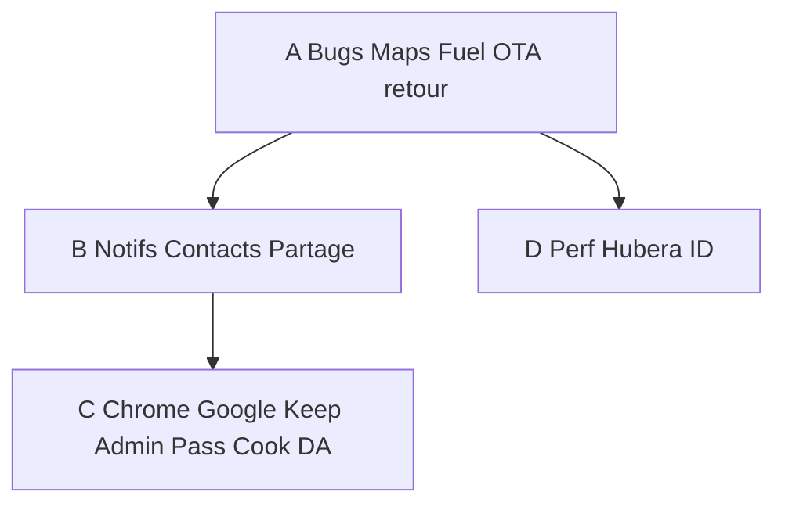

# Plan unique Hubera — 13 oct 2026

**Ce fichier est la seule source.** Lots 0–10 du 12 oct : **clos** (livrés). Les anciens plans Cursor / `docs/PLAN.md` méta : **remplacés**. On n’en crée plus d’autres.

Test réel Paul (13 oct, 206 grise essence, labo + compte). Rien n’est « déjà bon » sans re-test.

Contraintes inchangées : pas de `docker compose down -v`, OTA `forceUpdate: false` / `mandatory: false`, overlay Samsung + Blackview `-r`, **pas d’ADB Nothing**, Watchtower OFF, dual APK. Secrets jamais dans git/Docs/mail.

Modèle UX : **Google** (Gmail / Maps / Calendar / Keep / Drive) + chrome **Hubera Music** (OTA, compte, retour). Palette par app, même mécanique.

Ordre : **A (Maps / Fuel / OTA / retour)** → **B (notifs, contacts, partage)** → **C (chrome Google, Keep, Admin, Pass, Cook FR, DA)** → **D (perf ID)**. DA Contacts/Cook/Drive **après A**, pas avant les bugs jauge / voix / sombre / OTA.

---

## A — Maintenant (Maps, Fuel, OTA, bouton retour)

### A1. Maps : mode sombre en guidage — **code 0.1.94, APK pas encore overlay**
HUD / tuiles / chrome restent sombres une fois l’itinéraire démarré (`body.nav.night`). Auto = thème système **ou** 21h–6h.

### A2. Maps : commandes vocales — **code 0.1.94, APK pas encore overlay**
TTS recréé au retour premier plan, file d’attente, AudioFocus (duck Music), réannonce de la manœuvre. Plus de `speak` silencieusement perdu si le moteur Android a été coupé.

### A3. Fuel : jauge vs litres saisis (206 grise) — **code 1.4.173, APK pas encore overlay**
« Plein jusqu’au bouchon » **décoché par défaut**. Jauge = reste + litres. Jamais 100 % sans confirmation. Cas réel : 50,12 € · ~20 L · 1,990 €/L ≠ plein.

### A4. Fuel : trajet arrêté mais notif encore là — **code 1.4.173**
`stopBackgroundTracking` arrête **toujours** le FGS (même si l’OS dit « pas démarré ») et retire la notif « Hubera Fuel — suivi en cours ».

### A5. Fuel : essence basse → trajets réguliers — **code 1.4.173**
Si jauge warn/critique : « Encore ~N allers-retours Domicile ↔ Travail » selon **cette** voiture, km réels du corridor, sinon haversine × 1,35.

### A6. Fuel : plein > capacité réservoir — **code 1.4.173**
Plus de plafond silencieux. Si litres (ou reste+litres) > capacité : valider **Corriger** / **Réajuster le réservoir** / (si les litres seuls rentrent) **Jauge = litres saisis**.

### A7. OTA unique type Music, partout
Maps (et le reste) : **même popup** que Music (titre, notes, barre, **icône qui tourne**, Continuer / Télécharger), couleurs de l’app. Apps : Mail, Docs, Drive, Contacts, Pass, Jobs, Budget, Tasks, ID, Photos, Cook, Fuel, Notes, Office, Calendar, Maps, Music, Stream, CMS.

Téléchargement **en arrière-plan** : tuer le process ne relance pas un DL déjà commencé ; reprise du fichier cache.

### A8. Bouton retour ≠ quitter l’app
Cook (Paramètres), Calendar (Paramètres) et **toutes** les apps Hubera : Retour / Up → écran précédent ou accueil, **jamais** `finish()` de toute l’activité racine.

---

## B — Permissions, Contacts, partage, notifs

### B1. Mail
Au démarrage : vérifier **notifications**. Demander **fichiers** seulement au besoin. **Contacts** (Hubera Contacts **et** carnet téléphone) pour afficher les **noms** plutôt que les seules adresses.

### B2. Maps ↔ Hubera Contacts
Adresses enregistrées / suggestions : compte Hubera Contacts (déjà prévu, à re-vérifier). Pas une 2ᵉ base d’adresses.

### B3. Calendar
Notifs + contacts. Barre de recherche de **lieu** : propositions Maps (lieux enregistrés) **et** Contacts. Paramètres **dans Calendar**, pas ceux de Hubera ID.

### B4. Notes = Google Keep
Rappels sur note / liste → **notifications**. Bouton **+** : note, liste, rappel. Mobile **et** web. Analyser Keep (compte Google Paul) pour coller le comportement, pas inventer.

### B5. Jobs
- Notifications à envoyer (candidatures, relances) : **in-app + FCM existent** dans le code ; **mail métier : à confirmer en test** (pas « déjà bon »).
- Liste **contacts professionnels** Jobs (propre).
- Pouvoir **récupérer / proposer** une fiche depuis Hubera Contacts, et **créer** un contact Hubera depuis un candidat.

### B6. Photos
Partage vers Contacts (et flux partage Android).

### B7. Drive
Partager un fichier : personne **Hubera** (lien / droit) **ou** personne **externe** (lien). Rien de ça aujourd’hui dans l’app.

---

## C — Chrome type Google, Keep, Admin, Pass, Cook, DA

### C1. Calendar chrome
Création d’événement = **FAB / menu FAB**, pas le bordel actuel. Vues (jour / semaine / mois / agenda) dans le **drawer**, **pas** une bottom nav. **Retirer** les autres apps Hubera du drawer Calendar.

### C2. Chip compte (toutes les apps)
Comme Gmail / Maps Google, en haut à droite :
- popup **plusieurs comptes** ;
- accès **paramètres de cette app** ;
- **ajouter un compte** ;
- Hubera ID = confidentialité / gestion du compte (Hub), pas les réglages Calendar/Drive/etc.

### C3. Pass
Déverrouillage coffre : **empreinte** si dispo, **code 6 chiffres** (web + extension). De temps en temps redemander le **mot de passe complet**.

### C4. Admin — tâches natives
La partie **tâches** d’Hubera Admin = **vrai code mobile** (comme le web Docs/kanban), **pas** un navigateur / WebView dans l’app. Les tâches projet restent dans **Hubera Docs** (`docs.hubera.cloud`) ; Admin les affiche en natif.

### C5. Cook FR
Recettes / ingrédients : **traduire en français**. Illisible tel quel.

### C6. DA / kit commun
Contacts (actuel : illisible), Cook, Drive Paramètres, Calendar Paramètres : viser la **propreté Music / Fuel**. Socle graphique commun web+mobile **déjà demandé** — on l’applique ici, on ne redessine pas Music/Maps/Fuel tant que A n’est pas stable.

---

## D — Perf Hubera ID

Mail, Photos, Drive (et cousins) : chargement **trop long**. SSO Hubera ID : détecter le compte déjà connecté **sans** bloquer 10 s. Optimiser cold start + session.

---

## Hors scope de ce plan (déjà noté, pas maintenant)

Hubera Hub produit « compte Google », Contacts type Google Contacts **en produit neuf**, Calendar invitations riches : **après A+B**. Mesh ADB 3 téléphones : quand ADB Nothing est de retour.

---

## Live de référence (13 oct matin)

| App | Version | Note |
|-----|---------|------|
| Maps | 0.1.93 vc 94 | Overlay Samsung+BV. Bugs A1 A2 ouverts. |
| Music | 1.3.369 vc 10669 | OTA référence. Logo → apps. |
| Fuel | 1.4.172 vc 196 | Overlay. Bugs A3–A6 ouverts. |

OTA jamais forcée. Catalogue `hubera.cloud/updates.json` aligné.
